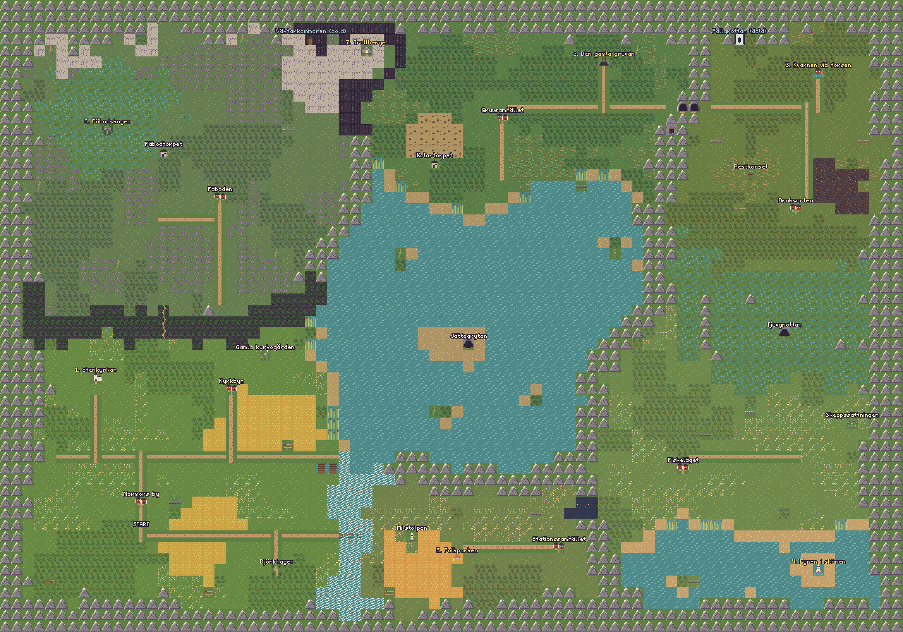
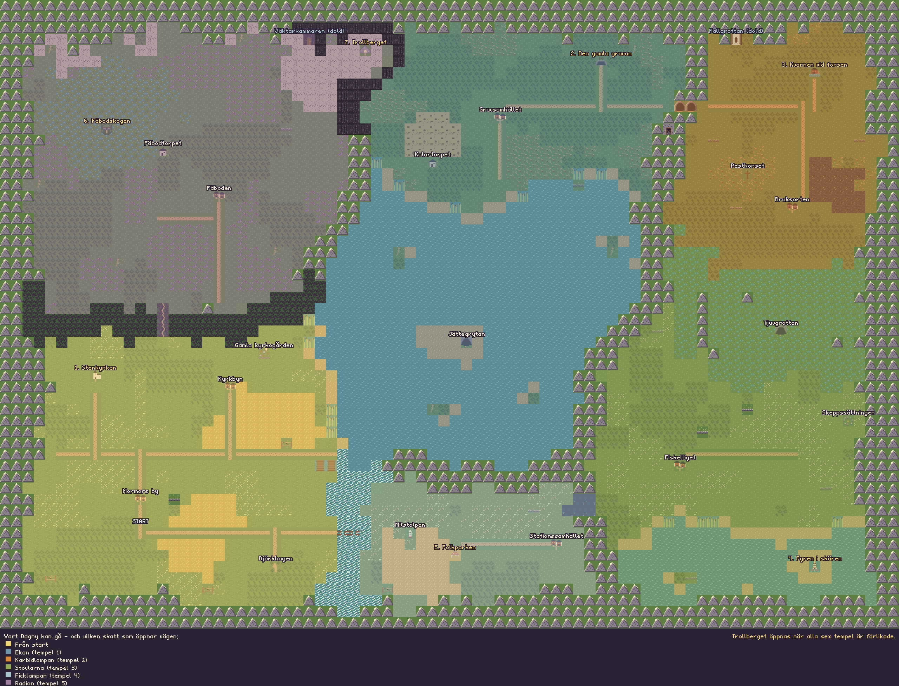

# The overworld

Drawn straight from `src/data/overworld.ts` with the game's own sprites.

## World map

80 × 56 tiles.
- Temples are marked in yellow with their number, villages and caves in white, and hidden places in light blue, marked "(dold)".
- **START** is where a new game begins, just below Mormors by.
- Hidden things are drawn open, as Dagny sees them with every treasure: the path through the spruce thicket, the door in the cliff below Trollberget, and the cave behind the waterfall.
- Each border is made of its own stuff: shore and reeds by the lake, a fell with mine adits, a wide marsh, the night forest, rapids with a washed-away bridge, a spruce thicket, and dark cliffs round Trollberget.
- The six small places (churchyard, charcoal croft, plague cross, stone ship, milestone, summer-farm croft) can all be visited, each with a little task. Walls, gates and overgrown paths are just scenery.

The full design (borders, fields, meetings, landmarks, hidden places) is in
[speldesign.md](../speldesign.md#the-overworld).

## Regions

Each colour shows where Dagny can first walk once she has the treasure
(computed with `reachableTiles` in `src/game/reach.ts`, the same logic the
game uses to check saves). The order is fixed – each region needs the treasure
of the temple before it:

```mermaid
flowchart LR
  S([Start: Mormors by]) --> K[1. Stenkyrkans krypta]
  K -- ekan --> G[2. Den gamla gruvan]
  G -- karbidlampan --> Q[3. Kvarnen vid forsen]
  Q -- stövlarna --> F[4. Fyren i skären]
  F -- ficklampan --> P[5. Folkparken]
  P -- radion --> Z[6. Fäbodskogen]
  Z -- alla sex förlikade --> T[7. Trollberget]
```

## Drawing them again

The pictures are made by a development tool. When the map changes:

1. Start the dev server: `npm run dev`.
2. Open <http://localhost:5173/tools/kartor.html>.
3. Click a picture's heading to save it, and replace the file here.

The same page also draws every side-view room, temple by temple, for
whoever wants a map of the rooms too. Code: `src/tools/maps.ts`.
